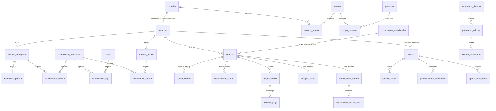

# Janery — Fase 1: propuesta de diseño

**Estado:** identidad, parámetros, auditoría, cuenta y libro implementados (migraciones V1 a V3, que agrupan identidad, parámetros y auditoría, y cuenta y libro). Créditos, ahorros, socios y fondos siguen siendo propuesta.

Este documento cubre lo que exige `base-datos.md` §4. Las tablas son una propuesta; los puntos marcados **PENDIENTE** dependen de `decisiones-pendientes.md` y no se implementarán por suposición.

## 1. Módulos del backend

Paquete raíz `ec.janery`, monolito modular:

| Módulo | Responsabilidad | Fase |
|---|---|---|
| `usuario` | Credenciales, login, tokens, cargos y permisos | 3 |
| `persona` | Datos personales, condición de cliente | 3 |
| `cuenta` | Cuenta principal, apertura, cierre, movimientos | 3 |
| `parametros` | CMS de parámetros, vigencias e historial | 3 |
| `auditoria` | Eventos de auditoría | 3 |
| `credito` | Letras, emergentes, promociones, encajes, ahorro letras | 4 |
| `ahorro` | Ahorro normal y plazo fijo | 4 |
| `socio` | Socios, aportes, participación, reserva | 5 |
| `caja` | Caja principal y caja chica | 3 (principal), 5 (chica) |
| `reportes` | Informes y exportaciones | 6 |

## 2. Diagrama entidad-relación



## 3. Tablas

Convenciones para todas: PK `id BIGINT` generada; dinero `NUMERIC(14,2)`; tasas `NUMERIC(9,6)` con su unidad; `creado_en TIMESTAMPTZ`; estados con `CHECK`.

### Identidad

| Tabla | Campos importantes | Restricciones |
|---|---|---|
| `usuarios` | correo, hash_contrasena, estado | correo `UNIQUE` |
| `personas` | usuario_id, datos personales (**PENDIENTE**: campos exactos) | usuario_id `UNIQUE` (1 usuario : 0..1 persona) |
| `cargos` | codigo, nombre | Los 8 cargos documentados |
| `permisos` | codigo, descripcion | Sin asignar a cargos: **PENDIENTE** |
| `usuario_cargos` | usuario_id, cargo_id, desde, hasta, asignado_por | Conserva el historial: revocar cierra `hasta` |
| `cargo_permisos` | cargo_id, permiso_id | PK compuesta |

### Cuenta y libro

| Tabla | Campos importantes | Restricciones |
|---|---|---|
| `cuentas_principales` | persona_id, numero (**PENDIENTE**: formato), estado, abierta_en, cerrada_en | Índice único parcial: una cuenta activa por persona |
| `depositos_apertura` | cuenta_id, importe_total, importe_ingreso, importe_reembolsable, parametro_valor_id, devuelto_en | `importe_ingreso + importe_reembolsable = importe_total` |
| `operaciones_financieras` | tipo, importe, estado, clave_idempotencia, referencia, reversa_de_id | clave_idempotencia `UNIQUE` |
| `movimientos_cuenta` | cuenta_id, operacion_id, sentido, importe, concepto | `importe > 0`; inmutable |

### Créditos

| Tabla | Campos importantes | Restricciones |
|---|---|---|
| `creditos` | persona_id, familia (`LETRAS`/`EMERGENTE`), modalidad, perfil (`SOCIO`/`CLIENTE`), importe o cupo, estado, condiciones_aplicadas `JSONB` | La modalidad es válida para su familia; instantánea obligatoria |
| `cuotas_credito` | credito_id, numero, vencimiento, capital, ahorro_letras, fondo_desgravamen, interes, total | `UNIQUE(credito_id, numero)`; `total` en dólares enteros |
| `desembolsos_credito` | credito_id, operacion_id, importe, fecha | Varias filas por crédito en el cupo de socio |
| `pagos_credito`, `detalles_pago` | operacion_id, importe; concepto e importe por detalle | La suma de los detalles iguala el pago |
| `encajes_credito` | credito_id, importe, pagado_en, devuelto_en | credito_id `UNIQUE` |
| `ahorro_letras_credito`, `movimientos_ahorro_letras` | credito_id; cuota_id, importe, tipo | credito_id `UNIQUE`; separado del ahorro normal |
| `promociones_estacionales` | tipo (`ESTUDIANTIL`/`NAVIDENO`), anio, abre_en, cierra_en | `UNIQUE(tipo, anio)` |

Las fórmulas de letras y de interés emergente siguen **PENDIENTES**: las tablas guardan el resultado, pero no se habilitará su cálculo sin aprobación.

### Ahorros

| Tabla | Campos importantes | Restricciones |
|---|---|---|
| `cuentas_ahorro` | persona_id, tipo (`NORMAL`/`PLAZO_FIJO`), nombre, estado, vence_en, condiciones_aplicadas | `vence_en` obligatorio solo en plazo fijo |
| `movimientos_ahorro` | cuenta_ahorro_id, operacion_id, sentido, importe, concepto | Inmutable |

### Socios y fondos

| Tabla | Campos importantes | Restricciones |
|---|---|---|
| `socios` | persona_id, desde, estado | persona_id `UNIQUE` |
| `aportes_socios` | socio_id, tipo (`OBLIGATORIO`/`PERSONAL`), importe, periodo, operacion_id | Categorías separadas |
| `aportes_caja_chica` | socio_id, importe, periodo, operacion_id | `UNIQUE(socio_id, periodo)`; separado del capital |
| `participaciones_mensuales` | socio_id, periodo, valor_inicial, variaciones, valor_final | **PENDIENTE**: fórmula |
| `cajas` | codigo (`PRINCIPAL`/`CHICA`/`FONDO_RESERVA`) | Fondos independientes |
| `movimientos_caja` | caja_id, operacion_id, sentido, importe, concepto | Inmutable; el servicio de caja no ofrece traspasos entre `PRINCIPAL` y `CHICA` |

### CMS y auditoría

| Tabla | Campos importantes | Restricciones |
|---|---|---|
| `parametros_sistema` | codigo, nombre, descripcion, tipo_unidad | codigo `UNIQUE` |
| `parametro_valores` | parametro_id, valor, unidad, vigente_desde, vigente_hasta, estado, creado_por, publicado_por, motivo | Vigencias sin solapamiento (`EXCLUDE`) |
| `historial_parametros` | parametro_valor_id, valor_anterior, valor_nuevo, actor, fecha, motivo | Inmutable |
| `auditoria_eventos` | actor, accion, modulo, entidad, entidad_id, antes, despues, motivo, referencia | Inmutable; sin secretos |
| `historial_estados` | entidad, entidad_id, estado_anterior, estado_nuevo, actor, fecha | Inmutable |

**Valores iniciales del CMS:** solo los documentados: apertura USD 20 (15 + 5), emergente de cliente (USD 300; 3,5 % y 0,25 % mensual), cupo de socio (USD 300; 0,12 % y 0,08 % diario), promociones (USD 50; 0,05 % diario; agosto y diciembre), aporte obligatorio USD 2,50, caja chica USD 2,50 y reserva 10 %. Las tasas de letras, encajes y ahorros quedan sin valor hasta que se definan, y el producto no se puede usar mientras tanto.

## 4. Estrategia de saldo y libro de movimientos

- Los movimientos son la fuente de verdad. El saldo disponible se obtiene sumándolos.
- Para el rendimiento y la concurrencia, cada cuenta guarda además un saldo actual, que se actualiza en la misma transacción y bajo bloqueo de fila. Una prueba de conciliación verifica que coincide con la suma del libro.
- El depósito reembolsable de USD 5 vive en `depositos_apertura`, nunca en `movimientos_cuenta`, de modo que no puede sumarse al saldo disponible.
- Toda operación monetaria crea una `operaciones_financieras` y sus movimientos en una sola transacción.
- Las correcciones se hacen con una operación inversa (`reversa_de_id`). Un trigger impide `UPDATE` y `DELETE` en las tablas de movimientos.
- Los pagos y desembolsos exigen la cabecera `Idempotency-Key`: un reintento devuelve el resultado original.

## 5. Estrategia de migraciones Flyway

- Esquema dedicado `janery`, creado por Flyway (`create-schemas: true`). `clean` queda deshabilitado.
- Una migración por módulo, en orden: `V1__identidad`, `V2__parametros_auditoria`, `V3__cuenta_libro`; después `V4__creditos`, `V5__ahorros`, `V6__socios_fondos`.
- Cada una se crea en la fase de su módulo. Una migración aplicada nunca se edita; los cambios van en una versión nueva.
- Hibernate solo valida (`ddl-auto: validate`).
- Las pruebas de integración usan el esquema aislado `janery_test`, que se recrea en cada ejecución.

## 6. Inventario de objetos a eliminar

**Ejecutado el 30/10/2026 con autorización del propietario.** Eliminadas de `public`, en la base `janery` de `localhost:5432`, sin `CASCADE`: `cargo`, `credito`, `cuenta`, `cuota`, `flyway_schema_history`, `movimiento_caja`, `movimiento_cuenta`, `pago_credito`, `parametro`, `socio` y `usuario`, con sus secuencias. Solo contenían 13 parámetros, 1 usuario y 1 registro de Flyway. El esquema `public` se conservó.

Respaldo previo: `respaldos/janery_previo_20261030.dump`.

## 7. Respaldo y restauración

Antes de eliminar nada, con `pg_dump` de `C:\Program Files\PostgreSQL\18\bin`:

```powershell
pg_dump -h localhost -p 5432 -U <usuario> -d janery -Fc -f respaldos\janery_previo_AAAAMMDD.dump
pg_restore --list respaldos\janery_previo_AAAAMMDD.dump
```

- La carpeta `respaldos/` está ignorada por Git. La segunda orden comprueba que el archivo se puede leer.
- Restauración: `pg_restore -h localhost -U <usuario> -d janery --clean --if-exists <archivo>`.
- Nunca se ejecuta `DROP DATABASE`, y `public` u otros esquemas solo se tocan con demostración de pertenencia y confirmación expresa.

## 8. Tokens y sesión (`seguridad.md` §4)

Propuesta:

- El backend emite los JWT firmados con HS256 y `JANERY_JWT_SECRET`; él mismo los valida como Resource Server.
- Access token de 15 minutos, guardado solo en memoria en Angular, nunca en `localStorage`.
- Refresh token de 7 días, rotado en cada uso, en cookie `HttpOnly`, `Secure` y `SameSite=Strict`. En la base solo se guarda su hash, y eso permite revocarlo.
- El logout revoca el refresh token. El access token caduca solo.
- Contraseñas con BCrypt.

## 9. Ambigüedades detectadas

Además de las de `decisiones-pendientes.md`, estos puntos no están resueltos en la especificación:

1. **Entrada de dinero.** No se define cómo llega el dinero a la cuenta principal (efectivo en ventanilla, transferencia confirmada por tesorería, etc.). Es lo mismo que el «método de cobro de los USD 20» y bloquea la apertura de cuenta.
2. **Fondo de desgravamen en emergentes estacionales.** Solo se indica una tasa de 0,05 % diario. No se aclara si es interés únicamente o si también aplica el 0,08 % de desgravamen.
3. **Destino del fondo de desgravamen y del fondo de reserva.** No se define si son saldos en caja principal o fondos separados. La propuesta deja `FONDO_RESERVA` como caja propia; el desgravamen queda sin definir.
4. **Primer administrador.** Sin él nadie puede administrar el CMS, y los permisos por cargo están pendientes. Propuesta: un permiso técnico de administración de parámetros, otorgado a un único usuario inicial que indique el propietario.
5. **Socios fijos actuales.** Se necesita el listado de personas y, si existen, sus aportes y valores iniciales.
6. **Zona horaria de negocio.** Afecta al cierre de promociones y al interés diario. Falta confirmarla.
